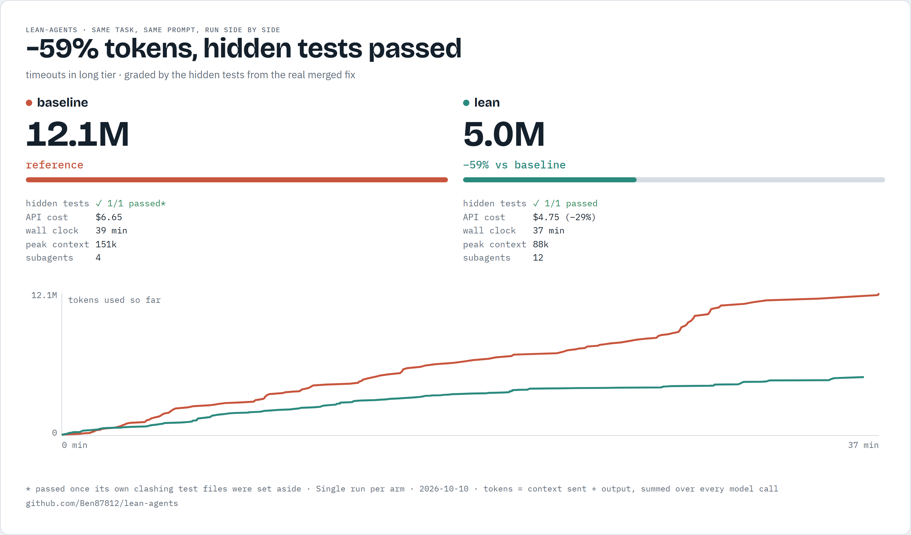

# lean-agents

Find out where your Claude Code tokens go, then cut them.

A Claude Code plugin for multi-agent and long-running sessions. It measures what your runs cost from Claude Code's own session logs, then cuts the cost with lean role agents, early hand-over and guards on reading.

It is useful on any multi-agent run and most useful on massive ones: the saving grows with the size of the run.

| Run | Size | Tokens saved |
|---|---|---|
| [Five bug fixes, Rich](#rich-five-bug-fixes) (open source) | minutes; no agent past 52k context | 38% |
| [Four features, pytest](#pytest-four-features) (open source) | about an hour; agents to 112k | 56% |
| [Command timeouts, go-task](#go-task-command-timeouts-graded-by-hidden-tests) (open source, graded by hidden tests) | about 40 minutes; agents to 151k | 59% |
| Multi-hour tasks, private codebase | about 15 hours a task; agents to 746k | 92% |

Quality held in all four; the go-task run was graded by tests the agents never saw. Each figure is a single run; see the caveats under each result. [Where it helps most](#where-it-helps-most) shows how to see what it will do for you.

## Why runs get expensive

Every model call re-sends the agent's whole context, so the cost of an agent grows with the square of its length. In audited runs:

- 88% of tokens were spent on calls with more than 100k of context: agents that never stopped;
- 30% were start-up context (tool, plugin and connector listings and CLAUDE.md), re-sent on every call, while the actual task prompt was about 1k;
- the rest leaked through whole-file reads, cache expiry during long waits, and the strongest model doing every job.

## What's inside

| Part | What it does |
|---|---|
| `skills/lean-agent-runs` | The run rules the lead agent follows: brief first, role agents only, hand over at about 25 rounds, runners for long commands, one build lane, capped reviews, measure before and after |
| `agents/` | `builder`, `fixer`, `reviewer`, `runner`, `shipper`: lean role agents (about 8k to 10k start-up instead of 35k to 55k) with turn caps, a model per role and built-in hand-over |
| `hooks/` | Read and shell guards: block whole-file reads and prints of large files and whole-branch diffs, and tell the agent to search and read a range instead |
| `scripts/agent-tokens.py` | Token, cost, start-up, big-context and per-role figures for any session, from `~/.claude/projects/`; `--diagnose` charges every token to its cause and flags agents that died, hung or looped |
| `bench/` | A benchmark graded by hidden tests: runs with and without the plugin side by side, with a spend cap, a report and a shareable card and replay |
| `skills/lean-agent-runs/settings-snippet.json` | Settings a plugin can't set for you: compact backstop, 1-hour subagent cache, output caps, connectors off |

## Where it helps most

**Measure first.** Run `scripts/agent-tokens.py` on a normal session. It shows how much of your spend goes to calls above 100k of context and to agent start-up. Those two figures are what this plugin cuts, so they tell you what it will save you. Add `--diagnose <session>` to see which causes your tokens went to, and the setting or rule that cuts each one.

- **Measured, not estimated.** Every figure here comes from saved session logs, before and after. On the private codebase (10 tasks), the quality checks (tests per changed line, CI passing first time, fix rounds per task) held level or improved.
- **The causes are general.** Every call re-sends the agent's whole context, and every agent carries a start-up load of tool, plugin and project listings. That is how Claude Code works for everyone.
- **Enforced, not suggested.** Rules in prompts alone did not work: agents ignored them and kept growing. Turn caps, lean agent types and blocking guards changed the numbers.
- **The biggest gains come from long-running agents.** Start-up savings apply to every run; the rest comes from stopping agents that would otherwise run long. In the private codebase's runs, agents grew to 746k of context without handing over, and the cut was 92%. The more of your spend sits above 100k of context, the larger your cut.
- **Good briefs matter most.** The lead agent writes a one-page brief per task. A thin brief sends agents back to exploring the codebase, and exploring is where tokens go.
- **Built for heavy use.** Many subagents, long sessions, several features at once. Short chats are already cheap.

Run the script before and after, and you will see your own number.

## Results on open-source repos

Each test gave one Claude Code run, Opus as the lead, real open issues with the same prompt, permissions and starting commit, once without the plugin and once with it. The skill was not named in either prompt; with the plugin installed, the lead picked it up on its own.

### Rich: five bug fixes

[Textualize/rich](https://github.com/Textualize/rich) (about 38,500 lines of Python), commit `9d8f9a3`, issues #4234, #4214, #4216, #4225 and #4215.

| | Without plugin | With plugin | Change |
|---|---|---|---|
| Tokens | 4.7M | 2.9M | −38% |
| Cost-weighted tokens | 1.1M | 0.7M | −36% |
| API-equivalent cost | $5.42 | $3.11 | −43% |
| Wall clock | 6.3 min | 6.8 min | same |
| Agent start-up (median) | 28.7k | 5.8k | −80% |
| Largest agent context | 52k | 24k | −54% |

Both runs fixed all five bugs, each with regression tests and a review, and introduced no test failures. With the plugin, the run added slightly more tests (1,002 passing against 994) and sent the riskiest fix to the strongest model for review.

No agent in either run passed 52k of context, so this saving comes from start-up and cheaper models per role alone: the floor on a light job. Everything needed to rerun it is in [`bench/rich`](bench/rich).

### pytest: four features

[pytest-dev/pytest](https://github.com/pytest-dev/pytest) (about 115,000 lines of Python with its tests), commit `e4f7f17`, feature requests #13580 (OSC 8 hyperlinks), #13169 (a line before each fixture's setup with `--setup-show`), #13198 (assertion introspection alongside diffs) and #14063 (a short summary that stays short at high verbosity). The full suite takes about 7 minutes.

| | Without plugin | With plugin | Change |
|---|---|---|---|
| Tokens | 17.3M | 7.6M | −56% |
| Cost-weighted tokens | 2.6M | 1.4M | −48% |
| API-equivalent cost | $11.05 | $5.63 | −49% |
| Agent start-up (median) | 28.7k | 5.9k | −80% |
| Largest agent context | 112k | 42k | −63% |

Both runs delivered all four features, each reviewed, with tests, documentation and a changelog entry, and no new test failures in a full-suite rerun (a timing-based test failed in one run and passed in the other). Without the plugin, the run added more test functions (26 against 15) and changed the default output for two features; with it, the lead kept both behind options (#13198 at `-v`, #14063 as a new setting) and left default output unchanged.

In both runs the lead stopped once while an agent was still working in the background, which ends a headless (`claude -p`) session; each was resumed with the same instruction to finish, and the figures cover both parts. The skill now tells the lead to wait for its agents in headless runs, and to hand every edit and investigation to an agent: with the plugin, the lead was 58% of the tokens. Everything needed to rerun it is in [`bench/pytest`](bench/pytest).

### go-task: command timeouts, graded by hidden tests

[go-task/task](https://github.com/go-task/task) (Go), commit `993508c`: add command timeouts (issue #1569), a 21-file change. The agents got the issue text. The tests from the real merged fix (PR #2898) were hidden from them and run afterwards: each clone holds no history past the starting commit, so no agent could reach the fix or its tests. Both runs went side by side, with the same prompt, model and permissions, and any installed copy of the plugin switched off in the run without it.



| | Without plugin | With plugin | Change |
|---|---|---|---|
| Tokens | 12.1M | 5.0M | −59% |
| Cost-weighted tokens | 1.75M | 1.00M | −43% |
| API-equivalent cost | $6.65 | $4.75 | −29% |
| Wall clock | 39 min | 37 min | about the same |
| Tokens on calls above 100k context | 45% | 0% | |
| Agent start-up (median) | 30.6k | 5.8k | −81% |
| Largest subagent context | 151k | 49k | −67% |
| Hidden tests passed | 1/1, once its own clashing test files were set aside | 1/1 | |

Caveats, plainly:

- **One run per arm.** Agent runs vary; treat the figures as one data point, not an average.
- **Both runs delivered working code.** Without the plugin, the run's own new test file defined a helper differently from the hidden test file, so the package did not compile until that file was set aside; then every hidden test passed. This is not a quality difference.
- **The saving is in tokens more than money or time here.** With the plugin, the lead agent became the biggest cost: 39% of the run's tokens, because its 39k start-up (system prompt plus every installed plugin's listings) is re-sent on each of its 28 calls. Its agents also wrote twice the output. So cost fell by 29%, and the run took about the same time, because the agents ran one after another. Both are what the next cuts target.
- **Two earlier attempts were thrown out**: in the first, the run without the plugin had the plugin installed; in the second, the runs could read each other's notes, and an agent in a third could reach the real fix through git history. The harness now prevents all three.

The [replay](bench/results/2026-10-10-long/post-replay.mp4) shows both runs as they happened. To rerun it, see [`bench`](bench).

## Keep cutting

1. `scripts/agent-tokens.py --diagnose <session>` shows where a session's tokens went, by cause, with the setting or rule that cuts each one.
2. Try a cut on a branch.
3. Benchmark the current plugin and the cut as two arms with `bench/run.py`.
4. Merge only if the hidden tests pass as often, tokens fall by more than 10%, and the drop shows in the targeted cause. Every attempt goes in [`bench/CUTS.md`](bench/CUTS.md).

## Share your results

More runs on more codebases make the method better. After a run without the plugin and one with it:

```
python <plugin folder>/scripts/agent-tokens.py --share <before session> <after session>
```

It prints a Markdown table of numbers only: no prompts, paths, session ids or dates. Paste it into a [results issue](../../issues/new?template=results.yml).

## Install

In Claude Code:

```
/plugin marketplace add Ben87812/lean-agents
/plugin install lean-agents@lean-agents
```

Needs Python 3 on the PATH for the guards and the script, and Claude Code v2.1.271 or later (for `omitClaudeMd` in agents). The guards let everything through if Python is missing.

Then, once per repository:

1. Merge `skills/lean-agent-runs/settings-snippet.json` into the repository's `.claude/settings.json`.
2. Switch off plugins the repository never uses (`/plugin`): their listings are re-sent on every call.
3. Put generated files and big shared documents into `LEAN_ALWAYS_RANGED` (comma-separated path endings), so agents always read them by range.
4. Record a baseline: `python <plugin folder>/scripts/agent-tokens.py` in the repository lists sessions; add a session id prefix for the detail.

## Use

Ask Claude to build several tasks with subagents, or say "use lean-agent-runs". The lead writes a brief per task and spawns `lean-agents:builder` and the other role agents. Afterwards, run the script on the session and compare it with your baseline.

## Settings

| Variable | Default | Meaning |
|---|---|---|
| `LEAN_MAX_LINES` | 400 | Largest file that may be read or printed whole |
| `LEAN_MAX_RANGE` | 250 | Widest `sed -n` or `Select-Object` range |
| `LEAN_ALWAYS_RANGED` | empty | Path endings that are always read by range |

The role agents use `Bash`. On Windows without Git Bash, change `Bash` to `PowerShell` in `agents/*.md`.

## License

MIT. See [LICENSE](LICENSE).
